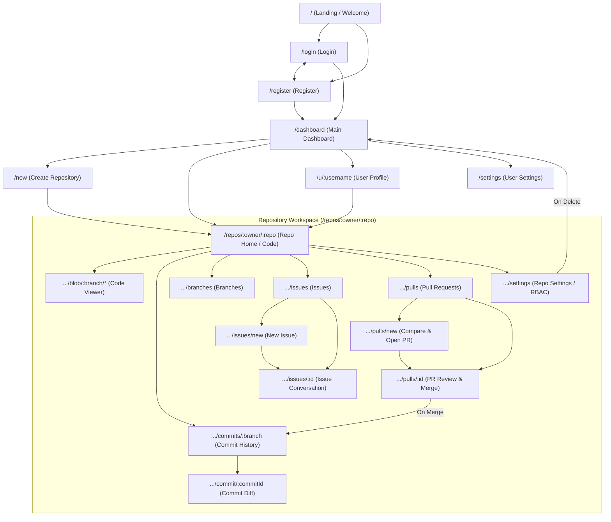

# TESTBOOK PAGE NAVIGATION & INTERCONNECTION MAP

This document defines all pages in Testbook, how they link to each other, user navigation triggers, access permissions, and their associated backend API endpoints.

---

## 1. Quick Navigation Flow Diagram



---

## 2. Detailed Page Directory & Interconnections

### 🟢 Authentication Layer (Public / Guest)

| Page Route | Page Name | Incoming Links From | Outgoing Links To | Trigger / Action | Associated API Endpoints |
| :--- | :--- | :--- | :--- | :--- | :--- |
| `/login` | **Login Page** | Landing, Register, Auth Guards | `/dashboard`, `/register` | Form Submit $\rightarrow$ JWT issued $\rightarrow$ Redirect to `/dashboard` | `POST /api/auth/login` |
| `/register` | **Register Page** | Landing, Login | `/dashboard`, `/login` | Form Submit $\rightarrow$ User created $\rightarrow$ Redirect to `/dashboard` | `POST /api/auth/register` |

---

### 🔵 Dashboard & Hub Layer (Protected)

| Page Route | Page Name | Incoming Links From | Outgoing Links To | Trigger / Action | Associated API Endpoints |
| :--- | :--- | :--- | :--- | :--- | :--- |
| `/dashboard` | **Dashboard / Feed** | Login, Navbar, Logo | `/new`, `/repos/:owner/:repo`, `/u/:username`, `/settings` | Displays user repos, recent activity feed, quick actions | `GET /api/repos`, `GET /api/activities` |
| `/new` | **Create Repository** | Dashboard, Navbar button | `/repos/:owner/:repo`, `/dashboard` | Submit repo name + visibility $\rightarrow$ Redirect to new repo | `POST /api/repos` |
| `/u/:username` | **User Profile** | Dashboard, Commit authors, Issue/PR authors | `/repos/:owner/:repo`, `/settings` | Displays public user profile, bio, owned repos, activity | `GET /api/users/:username` |
| `/settings` | **User Settings** | Navbar user dropdown | `/u/:username`, `/dashboard` | Update profile avatar, bio, change password | `PUT /api/users/me`, `PUT /api/auth/password` |

---

### 🟡 Repository Workspace Layer (Context: `:owner/:repo`)

All repository sub-pages share a common top bar (Breadcrumbs, Branch Switcher, Clone/Action buttons) and Repository Tab Bar.

| Page Route | Tab / Sub-Page | Incoming Links | Outgoing Links | Trigger / Purpose | Associated API Endpoints |
| :--- | :--- | :--- | :--- | :--- | :--- |
| `/repos/:owner/:repo` | **Code / Tree View** | Dashboard, Profile, Breadcrumbs | `.../blob/:branch/*`, `.../commits/:branch`, `.../branches`, `.../issues`, `.../pulls`, `.../settings` | Shows root file directory, branch switcher, README preview, latest commit | `GET /api/repos/:owner/:repo/tree/:branch` |
| `.../blob/:branch/:path` | **File Viewer** | Tree View, Commit Diffs | Tree View, Raw File, Edit File | View file contents with syntax highlighting | `GET /api/repos/:owner/:repo/files/:path?branch=:branch` |
| `.../commits/:branch` | **Commit History** | Code Tab, Branch Switcher | `.../commit/:commitId`, Code Tab | Chronological list of commits on selected branch | `GET /api/repos/:owner/:repo/commits?branch=:branch` |
| `.../commit/:commitId` | **Commit Detail / Diff** | Commit History, PR Commits | `.../commits/:branch`, Changed Files | Displays diff of added/modified/deleted files in commit | `GET /api/repos/:owner/:repo/commits/:commitId` |
| `.../branches` | **Branch Manager** | Code Tab dropdown | `.../tree/:branch`, `.../pulls/new` | List all branches, create branch, delete branch, open PR | `GET /api/repos/:owner/:repo/branches`, `POST /api/repos/:owner/:repo/branches` |
| `.../issues` | **Issues List** | Repo Tab Bar | `.../issues/new`, `.../issues/:id` | Filter open/closed issues, search issues | `GET /api/repos/:owner/:repo/issues` |
| `.../issues/new` | **New Issue** | Issues List "New" button | `.../issues/:id`, `.../issues` | Title + description markdown editor $\rightarrow$ Creates issue | `POST /api/repos/:owner/:repo/issues` |
| `.../issues/:id` | **Issue Details** | Issues List, Activity Feed | `.../issues`, Author Profile | Threaded comments, close/reopen issue actions | `GET /api/repos/:owner/:repo/issues/:id`, `POST /api/repos/:owner/:repo/issues/:id/comments`, `PATCH ...` |
| `.../pulls` | **Pull Requests List** | Repo Tab Bar | `.../pulls/new`, `.../pulls/:id` | Filter open/closed/merged PRs | `GET /api/repos/:owner/:repo/pulls` |
| `.../pulls/new` | **Compare & Open PR** | PR List, Branches List | `.../pulls/:id`, `.../pulls` | Select source & target branches, view diff before opening | `GET /api/repos/:owner/:repo/compare`, `POST /api/repos/:owner/:repo/pulls` |
| `.../pulls/:id` | **PR Code Review & Merge** | PR List, Activity Feed | `.../commit/:id`, Changed Files | Conversation, code review (Approve/Request Changes), Merge PR button | `GET /api/repos/:owner/:repo/pulls/:id`, `POST .../reviews`, `POST .../merge` |
| `.../settings` | **Repository Settings** | Repo Tab Bar (Owner only) | `/dashboard` (on delete), Member list | Manage RBAC (Owner/Contributor/Viewer), rename repo, delete repo | `GET/PUT/DELETE /api/repos/:owner/:repo`, `POST/DELETE /api/repos/:owner/:repo/members` |

---

## 3. Global Header Navigation (Persistent across all pages)

```
[Logo / Testbook] --------> /dashboard
[Search Repos] -----------> Global search modal / dropdown
[New Repository (+)] -----> /new
[User Avatar Dropdown]:
   ├── Profile -----------> /u/:username
   ├── Settings ----------> /settings
   └── Logout ------------> Clears token & redirects to /login
```
