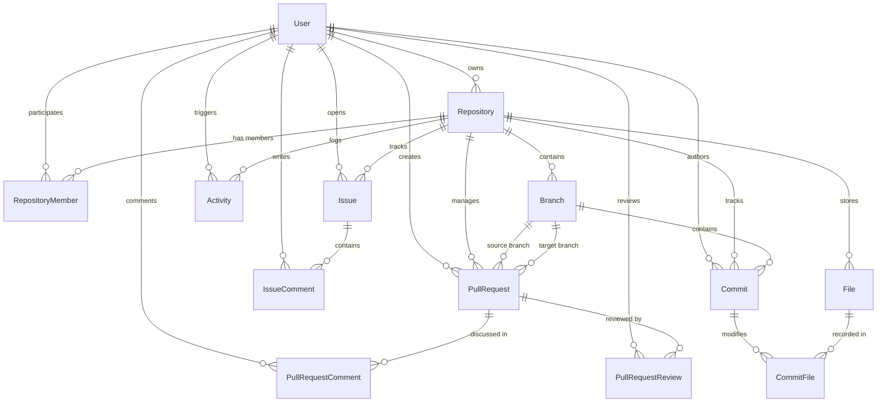

# Testbook Database Documentation

## 1. Overview & Architecture

Testbook uses a relational schema hosted on **Supabase PostgreSQL** and managed through **Prisma ORM** with direct connection pooling via `@prisma/adapter-pg`.

The database contains **13 models** and **8 enumerations**, designed to accurately represent a multi-tenant, version-controlled developer workspace with role-based permissions and audit logging.

---

## 2. Entity-Relationship (ER) Diagram

---

## 3. Enumerations

### `RepositoryVisibility`
- `PUBLIC`: Accessible to any authenticated user in read-only mode.
- `PRIVATE`: Restricted exclusively to the repository owner and approved members.

### `MemberRole`
- `OWNER`: Full administrative access, repository settings, member addition/removal, deletion.
- `CONTRIBUTOR`: Read/write access, branch creation, commit creation, issue management, PR reviews and merging.
- `VIEWER`: Read-only access to code, commits, and discussions.

### `CommitStatus`
- `ACTIVE`: Current active commit.
- `REVERTED`: Soft-reverted commit.

### `IssueStatus`
- `OPEN`: Active issue awaiting resolution.
- `CLOSED`: Resolved or closed issue.

### `PullRequestStatus`
- `OPEN`: Proposed changes under review.
- `APPROVED`: Peer review accepted; ready for merge.
- `CHANGES_REQUESTED`: Reviewer requested modifications.
- `MERGED`: Changes merged into target branch.
- `CLOSED`: Rejected or abandoned pull request.

### `ReviewStatus`
- `APPROVED`: Reviewer approves proposed changes.
- `CHANGES_REQUESTED`: Reviewer requests modifications before merging.
- `COMMENTED`: General peer discussion or feedback.

### `FileChangeType`
- `ADDED`: Newly created file in commit.
- `MODIFIED`: Edited existing file in commit.
- `DELETED`: Deleted file in commit.

### `ActivityType`
- `REPOSITORY_CREATED`
- `MEMBER_ADDED`
- `BRANCH_CREATED`
- `COMMIT_CREATED`
- `ISSUE_CREATED`
- `ISSUE_CLOSED`
- `PULL_REQUEST_CREATED`
- `PULL_REQUEST_MERGED`
- `PULL_REQUEST_CLOSED`

---

## 4. Table Descriptions

### `User`
Stores registered developers.

| Column | Type | Constraints | Description |
|---|---|---|---|
| `id` | String (CUID) | Primary Key | Unique user identifier |
| `username` | String | Unique | Chosen developer handle |
| `email` | String | Unique | User email address |
| `passwordHash` | String | Not Null | bcrypt hashed password (12 rounds) |
| `avatarUrl` | String | Nullable | Profile avatar image link |
| `bio` | String | Nullable | User biography or headline |
| `createdAt` | DateTime | Default `now()` | Registration timestamp |
| `updatedAt` | DateTime | Auto-updated | Last profile modification timestamp |

---

### `Repository`
Stores user code repositories.

| Column | Type | Constraints | Description |
|---|---|---|---|
| `id` | String (CUID) | Primary Key | Unique repository ID |
| `name` | String | Not Null | Repository slug/name |
| `description` | String | Nullable | Repository description |
| `visibility` | Enum | Default `PRIVATE` | `PUBLIC` or `PRIVATE` |
| `ownerId` | String | Foreign Key (`User.id`) | Repository creator |
| `createdAt` | DateTime | Default `now()` | Creation timestamp |
| `updatedAt` | DateTime | Auto-updated | Last activity timestamp |

- **Indexes**: `[ownerId]`, Unique `[ownerId, name]`.

---

### `RepositoryMember`
Join table establishing Role-Based Access Control (RBAC).

| Column | Type | Constraints | Description |
|---|---|---|---|
| `id` | String (CUID) | Primary Key | Membership identifier |
| `repositoryId` | String | Foreign Key (`Repository.id`) | Target repository |
| `userId` | String | Foreign Key (`User.id`) | Target user |
| `role` | Enum | Default `CONTRIBUTOR` | `OWNER`, `CONTRIBUTOR`, or `VIEWER` |
| `createdAt` | DateTime | Default `now()` | Addition timestamp |

- **Indexes**: Unique `[repositoryId, userId]`, Index `[userId]`.

---

### `Branch`
Represents an isolated line of development.

| Column | Type | Constraints | Description |
|---|---|---|---|
| `id` | String (CUID) | Primary Key | Branch identifier |
| `repositoryId` | String | Foreign Key (`Repository.id`) | Parent repository |
| `name` | String | Not Null | Branch name (e.g., `main`, `feature/auth`) |
| `createdAt` | DateTime | Default `now()` | Creation timestamp |

- **Indexes**: Unique `[repositoryId, name]`, Index `[repositoryId]`.

---

### `Commit`
Records a point-in-time snapshot of repository file changes.

| Column | Type | Constraints | Description |
|---|---|---|---|
| `id` | String (CUID) | Primary Key | Unique commit SHA/ID |
| `repositoryId` | String | Foreign Key (`Repository.id`) | Repository |
| `branchId` | String | Foreign Key (`Branch.id`) | Target branch |
| `authorId` | String | Foreign Key (`User.id`) | Committing user |
| `message` | String | Not Null | Commit message |
| `status` | Enum | Default `ACTIVE` | `ACTIVE` or `REVERTED` |
| `createdAt` | DateTime | Default `now()` | Commit timestamp |

- **Indexes**: `[repositoryId]`, `[branchId]`, `[authorId]`, `[createdAt]`.

---

### `File`
Metadata record for a repository file.

| Column | Type | Constraints | Description |
|---|---|---|---|
| `id` | String (CUID) | Primary Key | File identifier |
| `repositoryId` | String | Foreign Key (`Repository.id`) | Repository |
| `path` | String | Not Null | Relative path (e.g. `src/App.tsx`) |
| `storagePath` | String | Not Null | Path to file contents on disk |
| `size` | Int | Default `0` | File byte size |
| `mimeType` | String | Nullable | Content MIME type |
| `createdAt` | DateTime | Default `now()` | Creation timestamp |
| `updatedAt` | DateTime | Auto-updated | Last modification timestamp |

- **Indexes**: Unique `[repositoryId, path]`, Index `[repositoryId]`.

---

### `CommitFile`
Join table connecting commits to affected files and their mutation types.

| Column | Type | Constraints | Description |
|---|---|---|---|
| `id` | String (CUID) | Primary Key | Join record ID |
| `commitId` | String | Foreign Key (`Commit.id`) | Associated commit |
| `fileId` | String | Foreign Key (`File.id`) | Affected file |
| `changeType` | Enum | Not Null | `ADDED`, `MODIFIED`, or `DELETED` |

- **Indexes**: Unique `[commitId, fileId]`, Index `[fileId]`.

---

### `Issue`
Task and bug tracking record.

| Column | Type | Constraints | Description |
|---|---|---|---|
| `id` | String (CUID) | Primary Key | Issue identifier |
| `repositoryId` | String | Foreign Key (`Repository.id`) | Repository |
| `authorId` | String | Foreign Key (`User.id`) | Creator |
| `title` | String | Not Null | Issue title |
| `description` | String | Nullable | Detailed markdown description |
| `status` | Enum | Default `OPEN` | `OPEN` or `CLOSED` |
| `createdAt` | DateTime | Default `now()` | Creation timestamp |
| `updatedAt` | DateTime | Auto-updated | Modification timestamp |
| `closedAt` | DateTime | Nullable | Closure timestamp |

- **Indexes**: `[repositoryId]`, `[authorId]`, `[status]`.

---

### `IssueComment`
Discussion thread entry on an issue.

| Column | Type | Constraints | Description |
|---|---|---|---|
| `id` | String (CUID) | Primary Key | Comment identifier |
| `issueId` | String | Foreign Key (`Issue.id`) | Parent issue |
| `authorId` | String | Foreign Key (`User.id`) | Commenter |
| `content` | String | Not Null | Message body |
| `createdAt` | DateTime | Default `now()` | Timestamp |
| `updatedAt` | DateTime | Auto-updated | Edit timestamp |

- **Indexes**: `[issueId]`.

---

### `PullRequest`
Proposed merge request between two branches.

| Column | Type | Constraints | Description |
|---|---|---|---|
| `id` | String (CUID) | Primary Key | PR identifier |
| `repositoryId` | String | Foreign Key (`Repository.id`) | Repository |
| `authorId` | String | Foreign Key (`User.id`) | Creator |
| `sourceBranchId` | String | Foreign Key (`Branch.id`) | Branch with proposed changes |
| `targetBranchId` | String | Foreign Key (`Branch.id`) | Branch to merge into |
| `title` | String | Not Null | PR title |
| `description` | String | Nullable | Detailed notes |
| `status` | Enum | Default `OPEN` | `OPEN`, `APPROVED`, `CHANGES_REQUESTED`, `MERGED`, `CLOSED` |
| `createdAt` | DateTime | Default `now()` | Creation timestamp |
| `updatedAt` | DateTime | Auto-updated | Update timestamp |
| `mergedAt` | DateTime | Nullable | Merge timestamp |

- **Indexes**: `[repositoryId]`, `[authorId]`, `[sourceBranchId]`, `[targetBranchId]`, `[status]`.

---

### `PullRequestReview`
Peer review verdict on a pull request.

| Column | Type | Constraints | Description |
|---|---|---|---|
| `id` | String (CUID) | Primary Key | Review identifier |
| `pullRequestId` | String | Foreign Key (`PullRequest.id`) | Target PR |
| `reviewerId` | String | Foreign Key (`User.id`) | Reviewer |
| `status` | Enum | Not Null | `APPROVED`, `CHANGES_REQUESTED`, or `COMMENTED` |
| `comment` | String | Nullable | Review notes |
| `createdAt` | DateTime | Default `now()` | Review timestamp |

- **Indexes**: `[pullRequestId]`, `[reviewerId]`.

---

### `PullRequestComment`
Discussion thread comment on a pull request.

| Column | Type | Constraints | Description |
|---|---|---|---|
| `id` | String (CUID) | Primary Key | Comment identifier |
| `pullRequestId` | String | Foreign Key (`PullRequest.id`) | Target PR |
| `authorId` | String | Foreign Key (`User.id`) | Commenter |
| `content` | String | Not Null | Comment body |
| `createdAt` | DateTime | Default `now()` | Timestamp |
| `updatedAt` | DateTime | Auto-updated | Edit timestamp |

- **Indexes**: `[pullRequestId]`.

---

### `Activity`
Audit log of repository events.

| Column | Type | Constraints | Description |
|---|---|---|---|
| `id` | String (CUID) | Primary Key | Activity identifier |
| `repositoryId` | String | Foreign Key (`Repository.id`) | Repository |
| `userId` | String | Foreign Key (`User.id`) | Triggering user |
| `type` | Enum | Not Null | Event type |
| `message` | String | Nullable | Human-readable log string |
| `createdAt` | DateTime | Default `now()` | Timestamp |

- **Indexes**: `[repositoryId]`, `[userId]`, `[createdAt]`.
