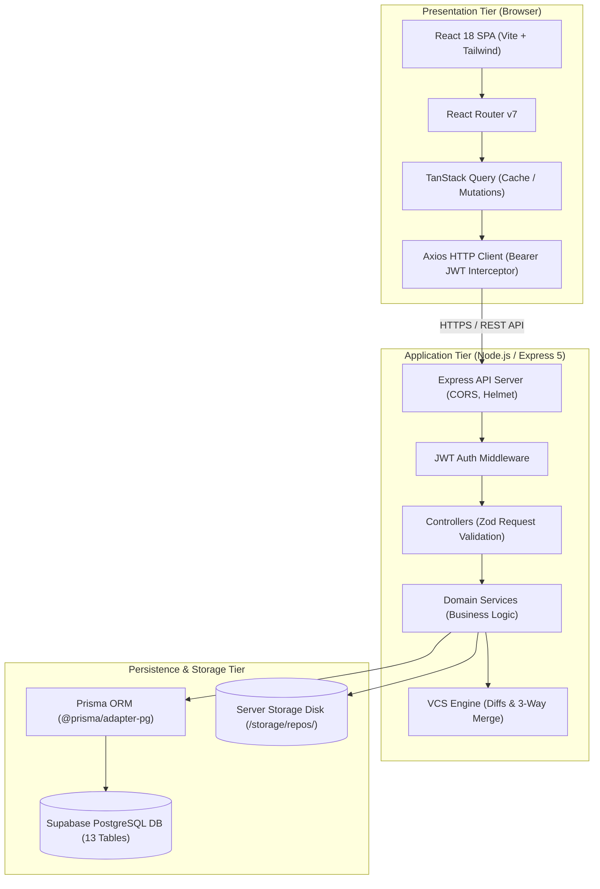
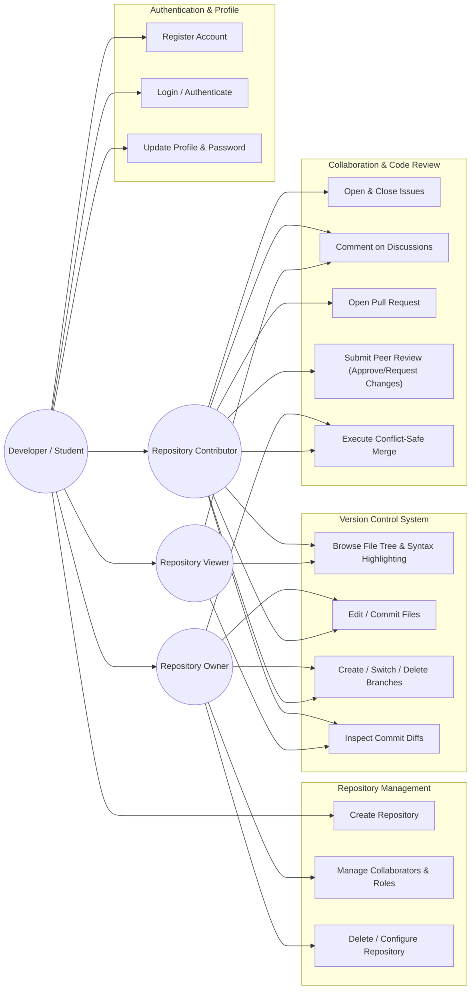
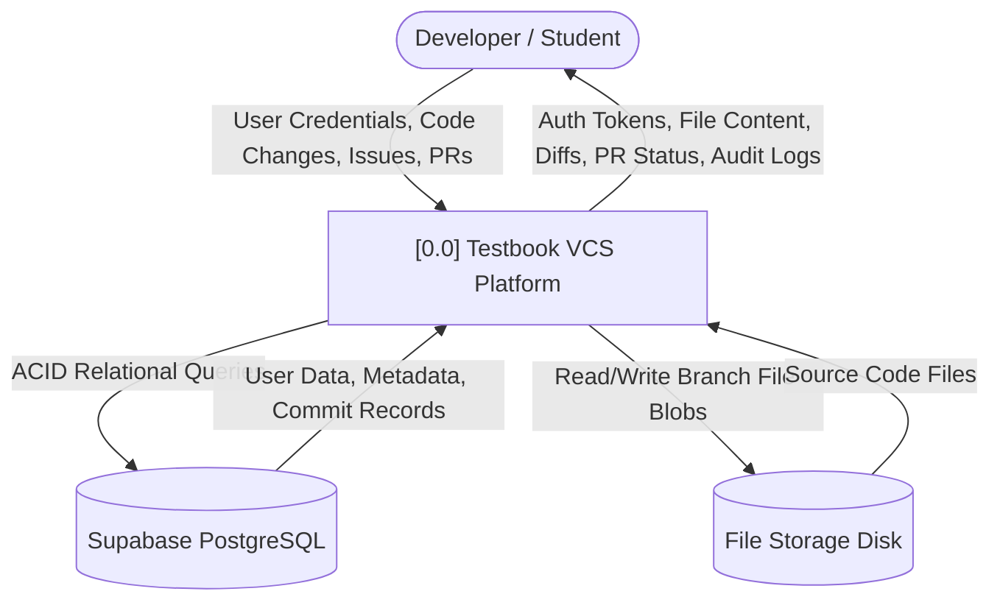
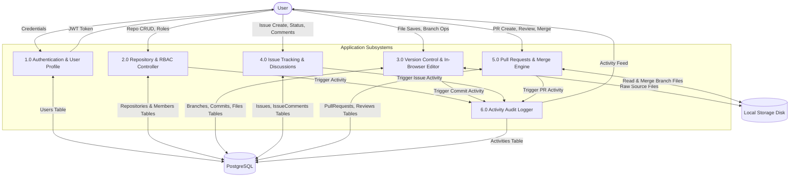
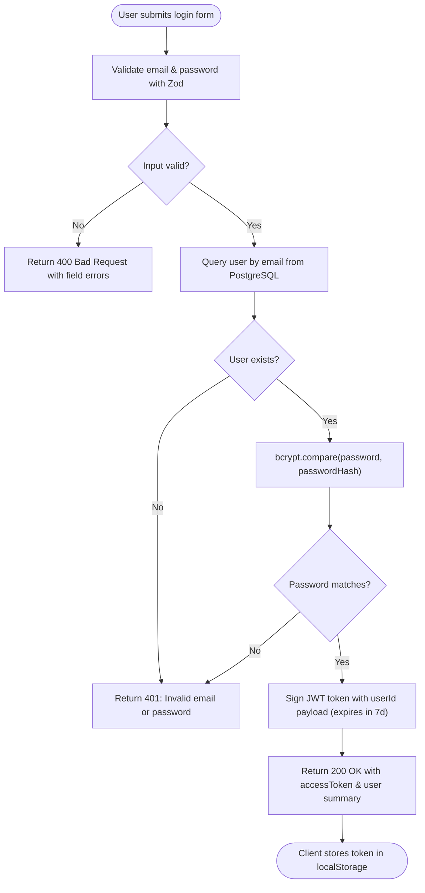
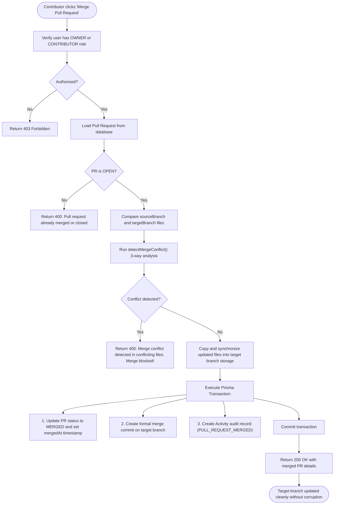

# Testbook System Design Documentation

---

## 1. System Architecture Diagram

---

## 2. Use-Case Diagram

---

## 3. Data Flow Diagrams (DFD)

### Data Flow Diagram — Level 0 (Context Level)

---

### Data Flow Diagram — Level 1 (Detailed Subsystems)

---

## 4. Key Workflows & Flowcharts

### A. Authentication & JWT Validation Flow

---

### B. Pull Request 3-Way Merge Conflict Detection & Merge Flow

